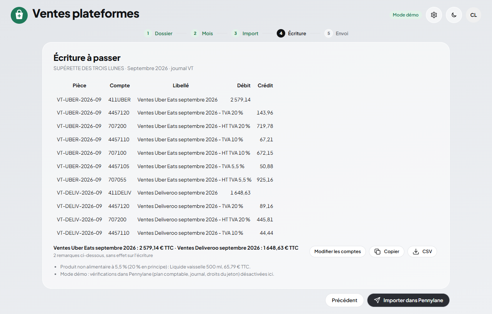
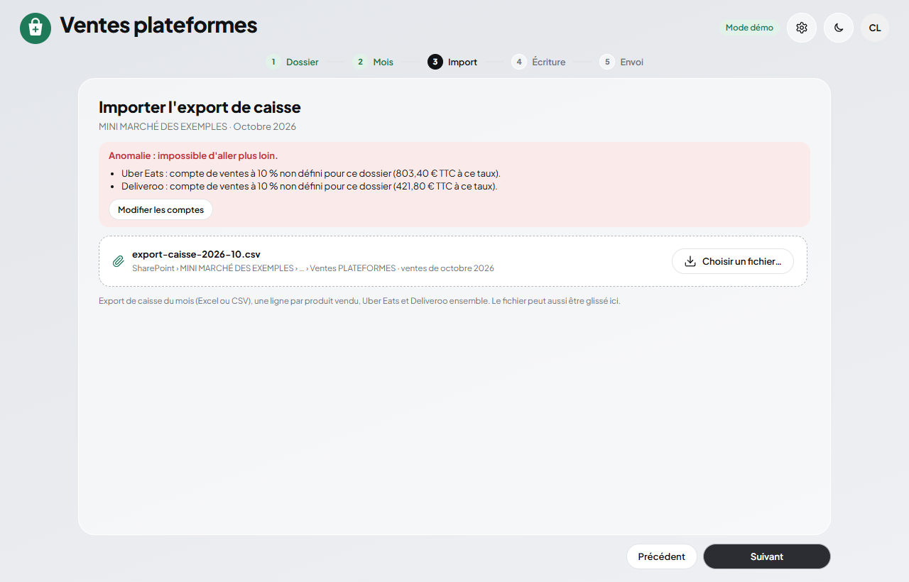

# Ventes plateformes

Some of the convenience stores we keep the books for sell through Uber Eats and Deliveroo.
Every month their till system exports one line per product sold: order, platform, price, discount, VAT rate.
A store has a few thousand of those lines a month, with 5.5 %, 10 % and 20 % VAT mixed in the same order, product discounts, cancelled orders and items that were never served.
Turning that into a sales entry meant filtering and summing in a spreadsheet, store by store, month after month, and it was easy to be a few cents off or to miss a dish soap sold at the food rate.

I built this tool so that it takes the export and gives back a checked journal entry.

## How the numbers are computed

For each platform and each VAT rate:

- **TTC** = sum of (Product Price − Product Discount) over the completed orders of the month
- **HT** = TTC / (1 + rate), rounded to the cent (half away from zero)
- **VAT** = TTC − HT, so HT + VAT is always exactly the TTC

Everything is done in integer cents, with rates in hundredths of a percent (5.5 % = 550), so there is no float rounding anywhere.
Then it builds one entry per platform per month in the sales journal, dated the last day of the month: debit the platform's customer account, credit sales and output VAT for each rate.

Example, Uber Eats in March 2026:

| Rate | TTC | HT | VAT |
|---|---:|---:|---:|
| 5.5 % | 1,234.56 | 1,170.20 | 64.36 |
| 10 % | 312.40 | 284.00 | 28.40 |
| 20 % | 89.90 | 74.92 | 14.98 |

gives `VT-UBER-2026-03` dated 31/03/2026: debit 411UBER 1,636.86, credit 707055 / 707100 / 707200 for the HT and 4457105 / 4457110 / 4457120 for the VAT.

Before anything is posted, it checks the file. It stops if the month has no sales, if two stores are mixed, if a VAT rate is unexpected or if an account is missing.
It warns when an order total doesn't match its lines, when the same product shows up at two rates, or when a non-food product (dish soap, batteries, beer…) is sold at a reduced rate.

## What it does around that

- Lists the stores you follow and proposes the next month to post
- Finds the month's export by itself in the client's SharePoint folder (Microsoft Graph, read only), or you drop the file in
- Reads the store's accounts from its past entries in Pennylane, or from its chart of accounts, and lets you fix them
- Works with or without Pennylane: with an API token the entry is created in Pennylane (never twice), without one you download a CSV journal (date, journal, entry, account, label, debit, credit) for any accounting software

I wrote it in plain PHP 8 and JavaScript, without a framework, so it runs on basic shared hosting.

## Try it

You need PHP 8.2+ with `mbstring`, `openssl`, `zip` and `simplexml`. No account, no internet.

- Windows: `demo.bat`
- macOS / Linux: `./demo.sh`

Then open http://127.0.0.1:8104 (login `demo` / `demo`, it logs in by itself). The demo has three made-up stores with two months of fake exports in a simulated SharePoint folder. Microsoft and Pennylane are switched off and sending is simulated.
To try the import by hand, use the files in `exemples/` (September 2026 as CSV, October 2026 as Excel, and a store list to import). `php outils/generer_exemples.php 2027-01` writes new ones for any month.

## Use it for real

1. Copy `config.exemple.json` to `config.json` and set the user accounts (`comptes`), and if you want them, your Microsoft Entra app ID and SharePoint paths.
2. Run `php outils/initialiser.php`: it creates the accounts and prints their temporary passwords once.
3. Point the web root to `public/` (an `.htaccess` is included for Apache), or run `php -S 127.0.0.1:8104 -t public public/routeur.php`.
4. In Settings, paste your Pennylane API token and connect your Microsoft account if you use them, and check the journal code and default accounts.

## Tests

`pip install pytest requests cryptography openpyxl` then `python -m pytest tests -q`.
The VAT split is checked against a separate Python `Decimal` implementation on every amount from 0 to 20.00 and on thousands of random ones. The other tests run the real PHP server against fake Microsoft, SharePoint and Pennylane servers, both with and without Pennylane, and check that the demo never makes an outside request.

## Limits

- It only knows the 5.5 %, 10 % and 20 % French rates and the column names of one till export format. Another format would need a small mapping.
- The non-food check is a keyword list, so it is a warning, not a guarantee.
- Data is stored in JSON files: fine for a small firm, not for hundreds of users.
- Microsoft and Pennylane are only tested against simulated servers in this repo.

The interface is in French, since it was made for a French firm.

MIT licence. Made by Mehdi Mobtahij.
